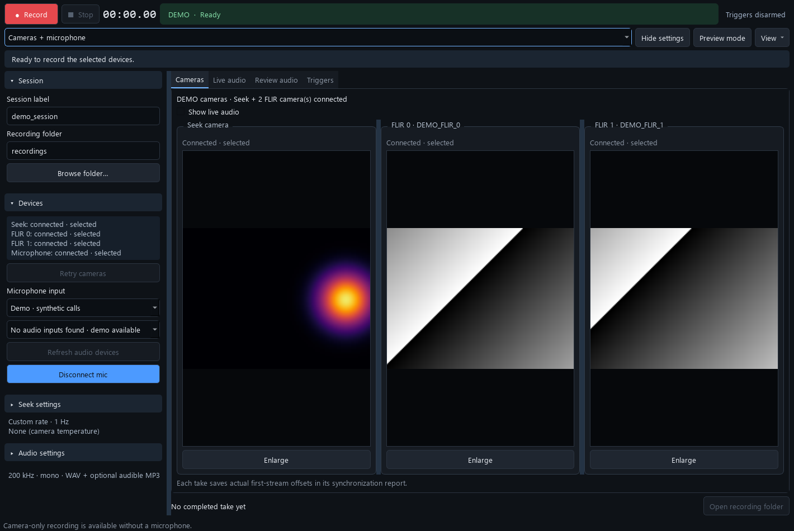

# Ultramic Studio 0.1.2

A Windows desktop recorder for Dodotronic Ultramic 200K microphones, with an optional
combined Seek thermal / FLIR camera recorder. Includes editable Python source,
synthetic demos, recorder tests, and an optional Arduino TTL bridge.

The recorder now has a cleaner dark layout, expandable settings, visible
readiness explanations, and an optional live spectrogram below the cameras.
Record, Stop, elapsed time, and trigger status remain visible across views.
See the [recorder interface guide](docs/RECORDER_GUI.md).

This is the **source distribution**. Install Python and the dependencies below.
Camera SDKs, drivers, recorded sessions, model weights, and bundled executables
are obtained or generated separately.



## Quick start on Windows

Install **64-bit Python 3.12** from [python.org](https://www.python.org/downloads/windows/),
including the Python launcher. Extract or clone the source into a writable folder.

**Microphone recorder:**

```bat
Setup_Windows.cmd
Start_Ultramic_Studio.cmd
```

Choose **Demo · synthetic calls** to try it without a microphone, or run
`Start_Ultramic_Studio.cmd --demo`.

**Combined recorder, without camera hardware:**

```bat
Setup_Windows.cmd --camera
Demo_Sync_Recorder.cmd
```

The demo simulates Seek, two FLIR cameras, and microphone audio. Record and Stop
remain manual. Demo recordings are labelled DEMO.

For real cameras, install the licensed Seek SDK and matching vendor Spinnaker/PySpin
package as described in [setup](docs/SETUP.md), then run
`Start_Sync_Recorder.cmd`. The unrelated PyPI package named `pyspin` is not the
FLIR SDK.

## Recording modes

| Mode | Devices and output |
| --- | --- |
| Standalone microphone | Native 200 kHz mono PCM16 WAV, live spectrogram, WAV review, optional 10× time-expanded MP3 |
| Cameras only | Seek thermal CSV and segmented Seek/FLIR MP4 previews, timing logs and take reports |
| Cameras + microphone | Camera outputs plus aligned PCM WAV and separate optional pre-trigger audio |
| Seek only | Thermal CSV and segmented Seek MP4 preview; no FLIR or microphone required |
| FLIR only | Segmented MP4 files from connected FLIR cameras; no Seek or microphone required |
| Microphone only | Normal-speed MP3; temporary WAV is retained if conversion fails |

The combined app starts in **Cameras only** mode. For combined audio, select
**Cameras + microphone**, select an input, and click **Connect & monitor** before
Record. Choose an output folder outside the source checkout.

Resize the sidebar or use **Hide settings** and **Preview mode** for small screens.
Expand **Seek settings** or **Audio settings** for advanced controls. Use
**Show live audio** to monitor audio alongside the camera previews; the full
FFT and frequency controls remain in **Live audio**. Warnings persist above the
workspace, and completed takes have an **Open recording folder** action.
Double-click a camera to enlarge it. Live and review spectrograms have independent
frequency ranges, FFT size, zoom, and display controls.

Microphone serial metadata is optional and blank by default. A user-entered serial
is a label, not a hardware identity verified by the audio driver. The public source
ships with **None (camera temperature)** calibration; see [setup](docs/SETUP.md)
for registering a calibration you have independently measured.

## Cage ROI exporter

In the combined recorder choose **View → Cage ROI export…**, or run
`Start_Cage_ROI.cmd`, to open a finished recording and draw, move, or resize a
separate cage region for each mouse.
Review the boundaries and export native thermal pixels, per-frame temperature
summaries, and optional cropped Seek video parts. The window shows progress, elapsed time, estimated time
remaining, cancellation, and persistent completion or failure status.

The time slider selects both video and native thermal previews. Enlarged cage
previews preserve the selected region's aspect ratio. Export uses bounded buffers
and up to two compression workers, then verifies every saved archive.
See [the cage ROI guide](docs/CAGE_ROI.md) for output formats and validation.

## Timing and data

Recording uses host receipt timestamps and labelled audio timing estimates.
This does not establish physical simultaneity between independent USB devices.
Validate hardware timing and drift with a shared measured reference.

Use the original WAV and thermal CSV for analysis. MP3 is lossy; at 200 kHz,
audio frequencies above the 100 kHz Nyquist limit cannot be captured faithfully.
Camera MP4s are preview media, while thermal pixel temperatures remain in CSV.
The recorder reports gaps and recovery attempts; examine each take's status.

- [Synchronization, saved files, and recovery](docs/SYNCHRONIZATION.md)
- [Serial / localhost TCP triggers and Arduino firmware](docs/TRIGGERS.md)
- [Setup and troubleshooting](docs/SETUP.md)
- [Development, tests, and local builds](docs/DEVELOPMENT.md)
- [Validation record and hardware checks](docs/VALIDATION.md)
- [Publishing clean source to GitHub](docs/PUBLISHING.md)

## Project layout

| Location | Purpose |
| --- | --- |
| `ultramic_studio/` | Audio acquisition, WAV/MP3, spectrograms, triggers, and standalone GUI |
| Root Python modules | Combined GUI, camera acquisition, coordination, writers, and recovery |
| `tests/` | Synthetic and mocked recorder tests |
| `scripts/` | Source packaging, demo screenshots, and optional local Windows builds |
| `examples/`, `firmware/` | Trigger clients and optional Arduino TTL bridge |
| `docs/` | Setup, behavior, validation, and third-party notices |

Tests generate their own fixtures in temporary directories. Experimental recordings,
research-analysis tools, and pretrained models are outside this source distribution.

## License

Original project code is available under the [MIT license](LICENSE).
Dependencies and vendor SDKs retain their own terms; see
[third-party components](docs/THIRD_PARTY.md).
