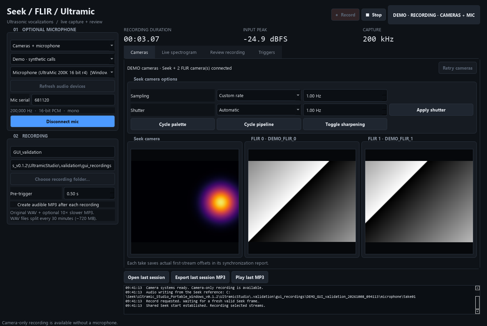
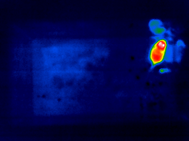

# Ultramic Studio

A Windows desktop recorder for the Dodotronic Ultramic 200K microphone and a
combined Seek thermal / FLIR camera setup. The source includes synthetic demos,
recorder tests, and optional Arduino TTL trigger firmware.

The combined recorder supports camera-only, camera-plus-microphone, Seek-only,
FLIR-only, and microphone-only recording. It includes persistent recording
status, expandable settings, live and review spectrograms, external triggers,
take reports, and a separate cage ROI exporter.



This repository contains editable source and setup instructions. Camera SDKs,
drivers, recordings, and bundled executables are supplied or generated
separately. See [third-party notices](docs/THIRD_PARTY.md) for dependency terms.

## Quick start on Windows

Use Windows 10 or 11 x64. The source setup is validated with **64-bit Python
3.12** and the Python launcher. Extract or clone the repository into a writable
folder.

### Try the combined recorder without hardware

```bat
Setup_Windows.cmd --camera
Demo_Sync_Recorder.cmd
```

The synthetic demo provides Seek, two FLIR cameras, and microphone audio. Record
and Stop remain manual; demo recordings are labelled **DEMO**. To start the demo
from an already configured environment, run:

```bat
Start_Sync_Recorder.cmd --demo-cameras --demo-audio
```

### Try the microphone recorder without hardware

```bat
Setup_Windows.cmd
Start_Ultramic_Studio.cmd --demo
```

The demo uses synthetic audio and does not need a microphone.

### Connect real devices

The repository and exported ZIP include the camera drivers in `drivers/` and the Seek SDK library in `camera_sdk/seek/`:
1. Right-click **`Install_Camera_Drivers.cmd` &rarr; Run as administrator** to register the Seek WinUSB (`seekusb.inf`) and FLIR USB3 drivers into the Windows DriverStore.
2. If the Seek Thermal camera shows a warning in Windows Device Manager, right-click it &rarr; **Update driver &rarr; Browse my computer for drivers** &rarr; select `drivers\Seek`. See [Camera Drivers Guide](docs/CAMERA_DRIVERS.md).
3. Connect the cameras and run **`Start_Sync_Recorder.cmd`**.

For FLIR cameras in an editable Python environment, ensure the vendor Spinnaker PySpin wheel is installed. The unrelated PyPI package named `pyspin` is not the FLIR SDK. Follow the [source setup and troubleshooting guide](docs/SETUP.md).

## Installation and portable builds

For a standard editable source setup, double-click `Setup_Windows.cmd` for the
microphone application, or use `Setup_Windows.cmd --camera` for the combined
recorder. The scripts create a local virtual environment and install pinned
dependencies. An Internet connection is required during installation.

To move the combined recorder to another Windows x64 PC, run
`Export_Sync_Recorder.cmd` on a development PC with the camera SDKs
installed (or use the pre-built `exports/SyncRecorder_Windows_x64.zip`). Copy and extract the ZIP, run `Setup_New_PC.cmd`, then
`Start_Sync_Recorder.cmd`. The transfer package includes its standalone executable,
application libraries, and complete camera drivers; vendor SDKs and drivers retain their own terms.
See [camera drivers guide](docs/CAMERA_DRIVERS.md).

See [setup](docs/SETUP.md) for real device requirements and
[development](docs/DEVELOPMENT.md) for tests and local builds.

## Recording modes

| Mode | Devices and output |
| --- | --- |
| Cameras only | Seek thermal CSV, Seek and FLIR MP4 previews, timing logs, and take reports; no microphone required. |
| Cameras + microphone | Camera outputs plus aligned PCM WAV and optional separate pre-trigger audio. |
| Seek only | Seek thermal CSV, video, and timing data; no FLIR or microphone required. |
| FLIR only | MP4 files from connected FLIR cameras; no Seek or microphone required. |
| Microphone only | Normal-speed MP3; temporary WAV is retained if conversion fails. |
| Standalone microphone | Native 200 kHz mono PCM16 WAV, live/review spectrograms, and optional 10× time-expanded MP3. |

The combined recorder starts in **Cameras only** mode. To record audio with the
cameras, select **Cameras + microphone**, choose an input, and click
**Connect & monitor** before Record. Select an output folder outside the source
checkout. The GUI keeps Record, Stop, elapsed time, readiness, and trigger status
visible across its camera and review views.

For small screens, resize the sidebar or use **Hide settings** and **Preview
mode**. Expand **Seek settings** or **Audio settings** for advanced controls.
**Show live audio** docks the spectrogram beneath the camera previews; the full
FFT and frequency controls remain available in **Live audio**. Double-click a
camera to enlarge it. Live and review spectrograms have independent frequency
ranges, FFT size, zoom, and display controls.

Microphone serial metadata is optional and blank by default. A user-entered
serial is a label, not a hardware identity verified by the audio driver. The
public source ships with **None (camera temperature)** calibration; see
[setup](docs/SETUP.md) for calibration guidance.

## Seek example output

This thermal frame is included as an example of the Seek output pipeline:



Seek saves thermal pixel data and timing information alongside its video
preview. The image is illustrative; use the CSV and frame data from a recording
for analysis.

To create the three-panel 24-hour figure, pass one native Seek thermal CSV per
mouse to the [portable figure tool](docs/SEEK_FIGURE_TOOL.md). It calculates a
7×7 mean around each frame's hottest pixel and supports any number of mice and
group labels.

## Cage ROI exporter

In the combined recorder choose **View → Cage ROI export…**, or run
`Start_Cage_ROI.cmd`, to open a finished recording and define a separate region
for each cage. Review the boundaries and export native thermal pixels,
per-frame temperature summaries, and optionally cropped Seek video parts. The
window shows progress, elapsed time, estimated time remaining, cancellation,
and completion or failure status.

The time slider selects both video and native thermal previews. Export uses
bounded buffers and verifies each saved archive. See the [cage ROI guide](docs/CAGE_ROI.md)
for output formats and validation details.

## Timing, triggers, and saved data

Camera timestamps use host receipt times; audio timing includes labelled driver
estimates. This software alignment does not establish physical simultaneity
between independent USB devices. Validate hardware timing and drift with a
shared measured reference.

Use the original WAV and thermal CSV for analysis. MP3 is lossy; audio above the
100 kHz Nyquist limit cannot be captured faithfully at 200 kHz. Camera MP4s are
preview media, while thermal pixel temperatures remain in CSV. Review each
take's status and gap reports.

- [Synchronization, saved files, and recovery](docs/SYNCHRONIZATION.md)
- [Serial, localhost TCP, and Arduino TTL triggers](docs/TRIGGERS.md)
- [Setup and troubleshooting](docs/SETUP.md)
- [Camera drivers and Device Manager setup](docs/CAMERA_DRIVERS.md)
- [Recorder interface guide](docs/RECORDER_GUI.md)
- [Development and local builds](docs/DEVELOPMENT.md)
- [Validation and hardware checks](docs/VALIDATION.md)
- [Project structure](docs/PROJECT_STRUCTURE.md)

## Examples and project layout

| Location | Purpose |
| --- | --- |
| `ultramic_studio/` | Standalone microphone application and combined recorder packages. |
| Root launchers and compatibility modules | Windows startup commands and supported legacy imports. |
| `examples/` | Python and MATLAB trigger clients. |
| `firmware/` | Optional Arduino TTL trigger bridge. |
| `docs/` | Installation, usage, output, and validation guides and images. |
| `scripts/` | Source packaging, synthetic screenshots, and optional Windows builds. |
| `tests/` | Synthetic and mocked recorder tests. |
| `.github/workflows/` | Windows CI for tests, demo recording, and source inventory. |

Tests generate fixtures in temporary directories. Experimental recordings,
research-analysis tools, and pretrained models are outside this source
repository. See the [project structure guide](docs/PROJECT_STRUCTURE.md) for
more detail.

## License

Original project code is available under the [MIT license](LICENSE). Dependencies
and vendor SDKs retain their own terms; see [third-party components](docs/THIRD_PARTY.md).
